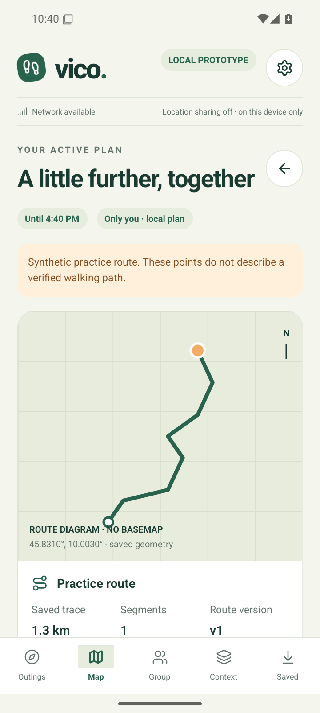

# Download Vico

## Android preview

[**Download Vico 0.1.0 — Android APK**](https://github.com/fabiogiacomini/Vico/releases/download/v0.1.0-preview.1/Vico-0.1.0-preview.1-android.apk)

[Release details, checksums and open source notices](https://github.com/fabiogiacomini/Vico/releases/tag/v0.1.0-preview.1).

This is an early development preview for local outings. Group chat and live location sharing are still being built. No Expo Go, computer connection or paid account is needed to open the installed app.

Requirements: Android 8/API 26 or later on an ARM64 phone. x86_64 is included for compatible devices and emulators; 32-bit devices are not supported.

1. Open this page on the Android phone and download the APK.
2. Open the downloaded file. If Android requests it, allow installation from the browser or file manager used for this trusted download.
3. Install Vico and choose **Explore the practice outing** to inspect the interface. Its route is synthetic, not a real trail.
4. Try creating a local outing or importing a GPX file. To delete an outing, open **Settings**, choose **Delete this outing permanently** and type **DELETE**.

Keep Android's security checks enabled. Managed devices can restrict APK installation. Updates must come from this repository and retain the project's signing identity. The release includes a SHA-256 checksum and public signing certificate information.

The current app provides saved outing workflows, GPX geometry, local meeting points, foreground positioning, encrypted local storage and optional weather. Detailed basemaps, map downloads, connected groups and active crowd feeds are not yet available. Missing crowd data does not mean an area is empty. Physical-device and field validation remain pending; this preview is not emergency or rescue software.

## iOS personal test

There is no public iPhone download yet. The first iOS test will use the owner's Mac, full Xcode, a connected iPhone and a free Apple Personal Team. See [the free-account guide](ios-free-account.md). Public iOS distribution will be evaluated after that test.

## Source and license

The source is public at [fabiogiacomini/Vico](https://github.com/fabiogiacomini/Vico). Vico's original code uses the [MIT license](../LICENSE); third-party components retain their own licenses and notices. Build and signing steps are documented in [Android distribution](android-distribution.md).

## Android preview screenshot

Synthetic practice outing on the API 35 emulator. This view is a route geometry diagram, not a detailed basemap.

